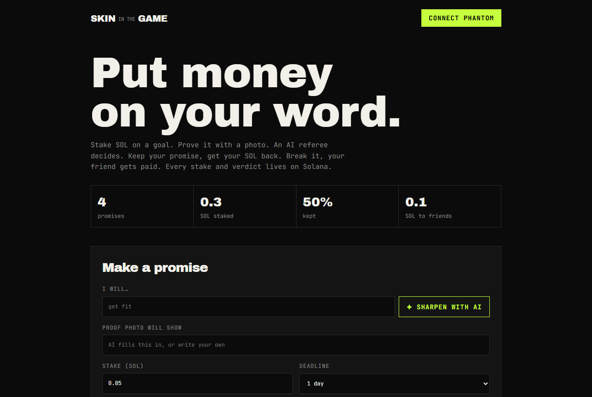
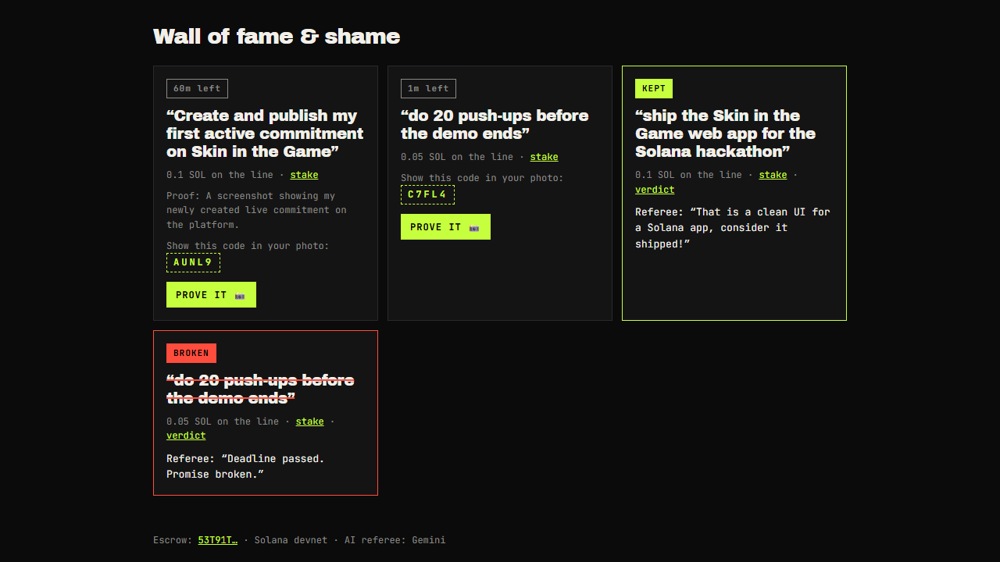
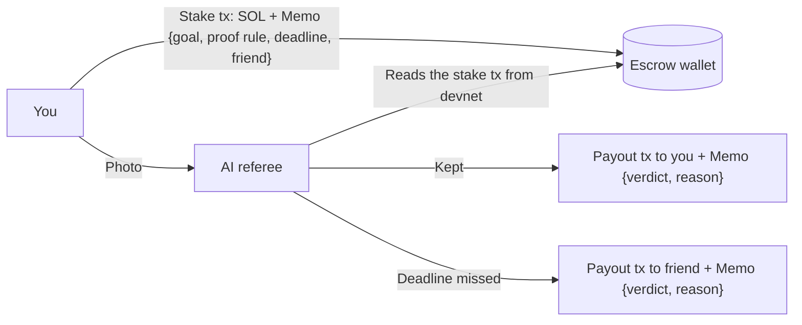

# Skin in the Game

**Put money on your word.**

Bet SOL that you will do something. Prove it with a photo. An AI referee decides.
Keep your promise and you get your SOL back. Break it and your friend gets it.
Every bet and every verdict is a real transaction on Solana.

| | |
|---|---|
| **Live app** | https://solana-hackathon-eight.vercel.app (Solana devnet + Phantom) |
| **Demo video** | [docs/demo.mp4](docs/demo.mp4) (98 s, real devnet transactions) |
| **Built for** | [MLH Solana Hackathon](https://www.mlh.com/events/solana-hackathon): AI, DeFi and Gaming tracks |



## The problem

Everyone breaks promises to themselves, because breaking them costs nothing.
Commitment contracts fix that: people try harder when money is on the line.
But today's apps hold your money privately and a human checks your proof by hand.

## What it does

1. **Make a promise.** Type a goal, even a vague one like "get fit".
2. **AI sharpens it.** Gemini rewrites it into a goal one photo can prove, like "Complete 5 push-ups in a row", and says exactly what the photo must show.
3. **Stake SOL.** Pick an amount, a deadline and a friend's wallet. One Phantom transaction locks the SOL and writes the goal on Solana.
4. **Get a secret code.** The app shows a 5-character code made from your transaction. Nobody could know it before you staked.
5. **Prove it.** Do the thing. Take a photo that shows the code (on paper or on screen).
6. **AI decides.**
   - Real proof with the code: your SOL comes back.
   - Stock photo, old photo or no code: rejected, with a reason. You can retry until the deadline.
   - Deadline missed: your friend gets your SOL.
7. **Wall of fame and shame.** Every promise, verdict and payout, rebuilt live from the chain.



## Where the AI works

Gemini is not a chatbot bolted on. It does three jobs, and its decisions move real money.

| Job | What it does | Why it matters |
|---|---|---|
| **Coach** | Turns a vague goal into a measurable one plus a proof rule | The rules are fixed on-chain before any money moves |
| **Anti-cheat** | Checks the photo shows the challenge code from the stake signature | Stock photos and reused photos fail |
| **Referee** | Judges the photo against the goal, the proof rule and the code | Its verdict refunds you or pays your friend, and its reason is written on-chain |

The referee needs a visible code and at least 70% confidence to pass. It ignores any other text in the photo, so "approve me" written on paper does nothing. If Gemini is overloaded, it falls back to a second model.

## How Solana is used



- **The chain is the database.** There is no database. A goal *is* its stake transaction. A verdict *is* its payout transaction. The wall is rebuilt from the escrow wallet's history.
- **The client cannot lie.** The server reads the amount, goal and deadline from the chain, never from the request.
- **No fake settlements.** A settlement only counts if the escrow wallet signed it, so nobody can post a fake "already paid" memo to block a payout.
- **No double payouts.** Escrow history is checked before every payout.

## Try it

1. Install [Phantom](https://phantom.app) and get free devnet SOL at https://faucet.solana.com.
2. Open https://solana-hackathon-eight.vercel.app and connect Phantom. Phantom's network setting does not matter; the app sends to devnet.
3. Type a goal, press **Sharpen with AI**, stake 0.05 SOL with a 3-minute deadline, and paste a friend's wallet.
4. Write the code from your card on paper, take a photo, and press **Prove it**.

## Run it yourself

```bash
npm install
npm run keygen          # makes a devnet escrow wallet in .env.local and prints its address
```

Add your Gemini key to `.env.local`:

```
GEMINI_API_KEY=your-key
```

Send some devnet SOL to the escrow address (it pays payout fees), then:

```bash
npm run dev             # http://localhost:5173, also serves api/*.js
npm test                # unit tests
```

Other scripts:

- `node --env-file=.env.local scripts/e2e.js` runs a full stake and payout on devnet without Phantom.
- `node --env-file=.env.local scripts/record-demo.mjs <fake-photo.jpg>` records the demo video.

**Deploy:** import the repo in Vercel and set `GEMINI_API_KEY` and `ESCROW_SECRET_KEY` (from `.env.local`).

## Code map

| Path | What it is |
|---|---|
| `index.html`, `src/` | The web app: Phantom connect, stake, prove, wall |
| `api/coach.js` | AI coach endpoint |
| `api/judge.js` | Reads the stake from the chain, runs the referee, pays out once |
| `api/wall.js` | Wall of fame and shame from escrow history |
| `lib/core.js` | Memo parsing, challenge code, payout decision (unit tested) |
| `lib/gemini.js` | Gemini calls with model fallback |
| `lib/chain.js` | Solana connection and trusted escrow history |

## Honest limits

- **The escrow is a wallet whose key sits on our server**, not an on-chain program, because there was no time to set up Rust and Anchor in this 8-hour build. You trust the server to pay out. Next step: an Anchor escrow program where the AI verdict is an oracle-signed instruction.
- Two settle requests for the same goal at the same instant could both pay. The on-chain program fixes this too.
- The AI can be wrong. A friend dispute flow is on the roadmap.
- Devnet only.

## Built with

Solana devnet, `@solana/web3.js`, System and Memo programs, Phantom, Gemini (`gemini-flash-lite-latest`), Vite, Vercel.
Built with Claude Code (Claude Opus 5.5) as an AI coding assistant.
